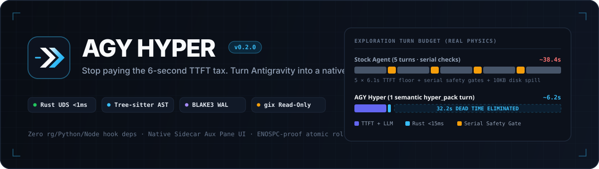
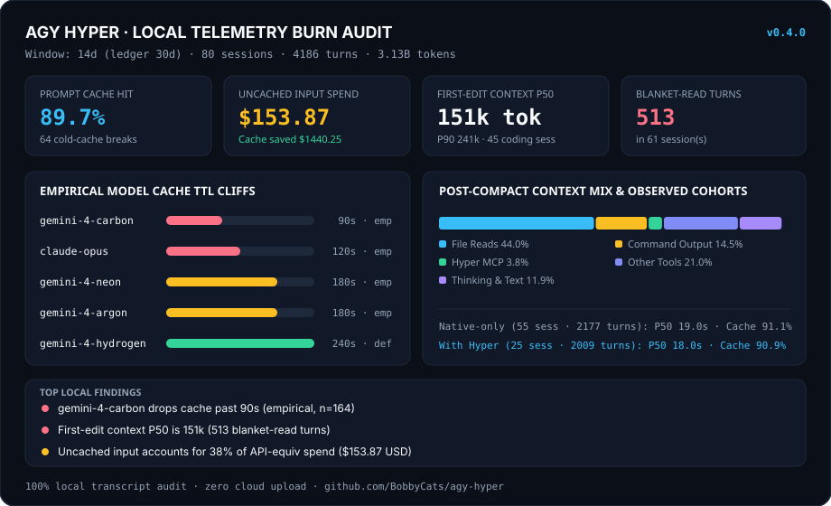
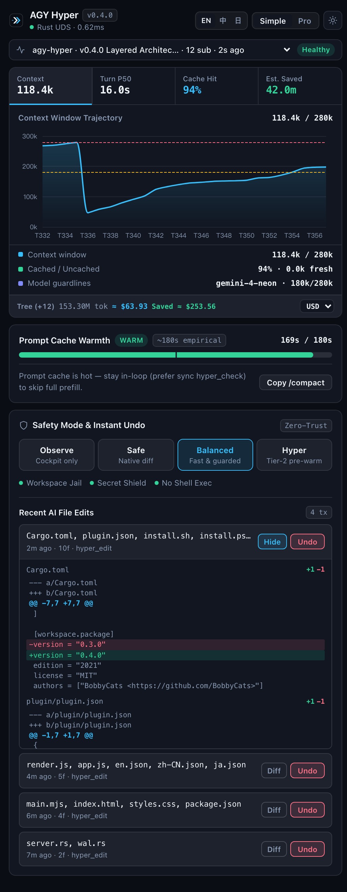
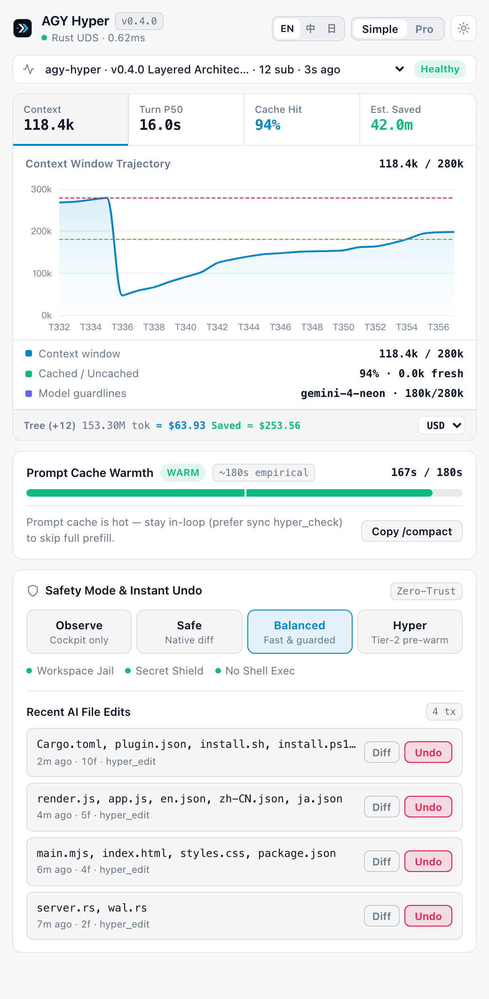
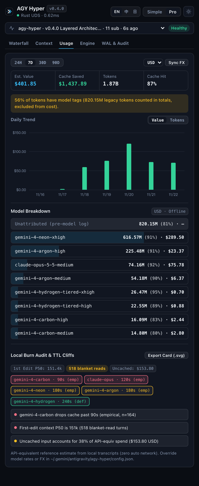
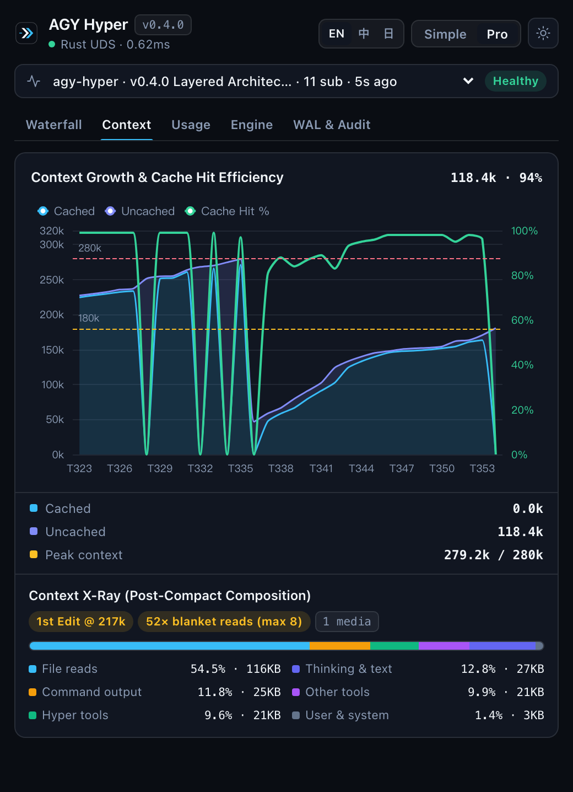
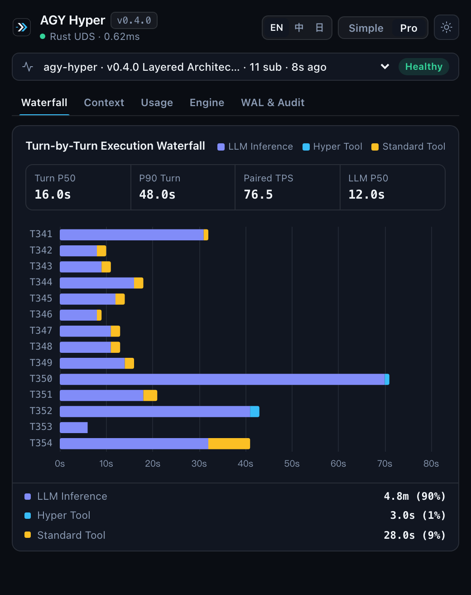
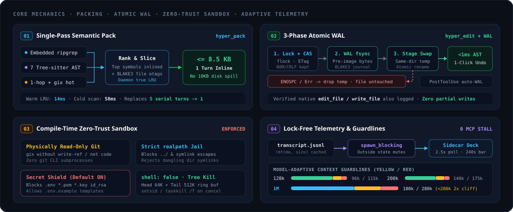
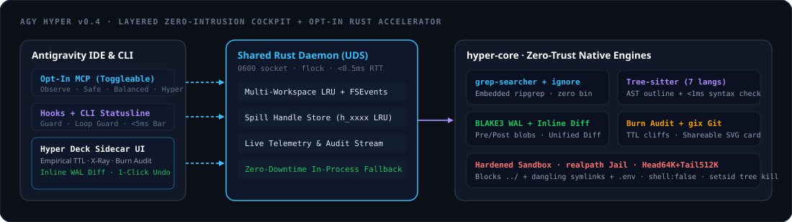

<div align="center">

<picture>
  <source media="(prefers-color-scheme: dark)" srcset="./assets/hero-dark.svg">
  <source media="(prefers-color-scheme: light)" srcset="./assets/hero-light.svg">
  
</picture>

<br/>

[](https://github.com/BobbyCats/agy-hyper/actions/workflows/ci.yml)
[](./LICENSE)
[](#architecture)
[](#reproducible-benchmarks)
[](#install-in-one-line)
[](https://x.com/BobbyCat2025)

**English** · [简体中文](./README.zh-CN.md) · [Quick Install](#install-in-one-line) · [AI One-Click](#ai-one-click-install) · [Hyper Deck](#agy-hyper-deck-native-sidecar-cockpit) · [Benchmarks](#reproducible-benchmarks) · [Uninstall](#uninstall--preserved-files) · [Contributing](./CONTRIBUTING.md)

</div>

---

You asked your AI agent to trace one auth middleware. It ran `glob`, then `grep`, read half a file that spilled past 10KB to disk, then guessed the next file — five serial round-trips and 38 seconds gone before writing a single line of code. Most of that wait is queuing for five separate model first-token floors.

**AGY Hyper cuts out the dead air.** One ~10MB static Rust engine collapses multi-turn codebase exploration into a single `14ms` cached pack, guards every multi-file edit behind crash-safe WAL 1-click Undo, and docks a live telemetry & cost cockpit right inside Antigravity's side pane.

> **100% Official Antigravity Plugin Protocol**: Built strictly on native MCP, Lifecycle Hooks, Rules, and `SIDECAR_UI_ENTRYPOINT_AUX_PANE`. Zero Electron DOM injection, zero `--remote-debugging-port` exposure, zero edits to `~/.gemini/config/config.json`, and zero conflicts with theme or localization plugins.

---

## Understand the Difference in 10 Seconds

Even if you never touch systems programming, three everyday comparisons tell the whole story:

### 1. Speed: Five Trips Back to the Shed vs. Walking In with the Blueprint
- **Without AGY Hyper**: You ask a handyman to fix a leak. He walks to the shed to inspect one pipe (wait 6s), walks back to ask where the wrench is (wait 6s), tries to carry a toolbox that's too heavy and drops it halfway (10KB output spill, wait 6s) — five round-trips and 38 seconds burned riding the elevator before touching a single bolt.
- **With AGY Hyper**: He walks in holding the full floorplan, meter readings, and the exact parts he needs in one hand. One `14ms` pass maps the neighborhood and gets straight to work.

### 2. File Safety: Permanent Marker on the Original vs. Vault Backup + Instant Undo
- **Without AGY Hyper**: Asking an AI to edit 5 files is like editing a signed contract in permanent marker. If page 3 crashes halfway, pages 1 and 2 are already mangled — and an overeager search might peek inside your `.env` secrets drawer.
- **With AGY Hyper**: Original bytes are locked into a local WAL vault first. Edits are drafted on temp scratch paper, syntax-checked in `<1ms`, and swapped in atomically. Bad edit? Hit **Undo** in the side pane and every file snaps back byte-for-byte. Secret files stay sealed by default.

### 3. Long Sessions & Subagent Trees: Driving Blind vs. Full Telemetry & Cost Cockpit
- **Without AGY Hyper**: You have no idea when your prompt cache actually cools for the model you're running, what files or command outputs silently bloated the context window, whether a background subagent has stalled or snowballed past redline, or how much API-equivalent value your last 7 days burned.
- **With AGY Hyper**: A live cockpit sits in Antigravity's side pane tracking exact context load, **auto-calibrated per-model cache TTL**, **Context X-Ray** composition, linked subagent trees (flagging active redlines and `STALLED` runs), post-`/compact` and cross-model cache resets, and an offline `24H / 7D / 30D / 90D` multi-currency usage ledger — plus a `<5ms` native statusline for Antigravity CLI.

---

## Install in One Line

No Rust toolchain, no `ripgrep`, no Python, no `git` CLI required. Release archives are **SHA-256 verified** before atomic swap and never touch `~/.gemini/config/config.json`.

```bash
# macOS & Linux (default Balanced mode; add `-s -- --observe` for zero-intrusion cockpit only)
curl -fsSL https://raw.githubusercontent.com/BobbyCats/agy-hyper/main/install.sh | bash
```

```powershell
# Windows (PowerShell; set `$env:AGY_HYPER_OBSERVE="1"` before install for Observe-only mode)
irm https://raw.githubusercontent.com/BobbyCats/agy-hyper/main/install.ps1 | iex
```

```bash
# Build from source
git clone https://github.com/BobbyCats/agy-hyper.git && cd agy-hyper && ./install.sh
```

### AI One-Click Install

Paste this prompt into **Antigravity, Claude Code, Codex, or Cursor** to install and verify automatically via the repository's [SKILL.md](./SKILL.md):

> Read `https://raw.githubusercontent.com/BobbyCats/agy-hyper/main/SKILL.md` and install AGY Hyper using the platform installer (`install.sh` on macOS/Linux or `install.ps1` on Windows), then run `agy-hyper doctor` and report the diagnostic results.

Switch back to Antigravity and everything activates automatically. You can also run diagnostics, usage reports, session waterfalls, or the standalone web cockpit from any terminal:

```bash
agy-hyper doctor                  # verify Tree-sitter grammars, gix, daemon RTT & security posture
agy-hyper audit --svg audit.svg   # run 14d local burn audit & export a shareable SVG diagnostic card
agy-hyper usage --window 7d       # view 24h / 7d / 30d / 90d tokens & API-equivalent value
agy-hyper bench --cache-ttl       # inspect empirical per-model prompt-cache TTL decay curves
agy-hyper cli-setup               # print (or --apply) Antigravity CLI statusLine & title config
agy-hyper ui                      # launch AGY Hyper Deck standalone at http://127.0.0.1:47821
```

---

## Local Burn Audit Card (`agy-hyper audit`)

Run `agy-hyper audit --days 14 --svg audit-card.svg` to audit your own Antigravity transcripts 100% locally (zero cloud uploads). It surfaces empirical per-model cache TTL cliffs, uncached input spend, pre-edit context bloat, blanket-read turns, and an unadjusted local cohort view in a crisp shareable SVG card:

<div align="center">
  <picture>
    <source media="(prefers-color-scheme: dark)" srcset="./assets/audit-card-dark.svg">
    <source media="(prefers-color-scheme: light)" srcset="./assets/audit-card-light.svg">
    
  </picture>
</div>

---

## AGY Hyper Deck (Native Sidecar Cockpit)

Docked directly in Antigravity's auxiliary pane via `SIDECAR_UI_ENTRYPOINT_AUX_PANE`, powered 100% offline by **Apache ECharts 6** and **i18next** (`English / 简体中文 / 日本語`, zero CDN). Luminance-synced with your host Light/Dark theme.

- **Layered Zero-Intrusion Design**: start in **Observe** mode (read-only cockpit + burn audit + passive WAL capture; native tools & diff cards untouched), switch to **Safe** (bundled reads & preset checks while keeping native `edit_file` inline diffs), or unlock **Balanced / Hyper** full Rust MCP acceleration — plus granular per-tool toggles (`MCP Read`, `MCP Edit`, `MCP Check`) under **Engine**.
- **Simple Mode** keeps daily essentials front and center: context level, Turn P50, step vs. session cache hit rate, linked subagent tree strip (highlighting active redlines and `STALLED` subagents silent `>=90s`), session/tree usage ribbon with quick currency switch, **auto-calibrated per-model cache warmth bar** (empirical vs. default TTL badge & loop-guard alerts), 4-mode layered profile switch, and **inline WAL Unified Diff preview + 1-click Undo**.
- **Pro Mode** opens five deep telemetry tabs: **Waterfall** (disjoint LLM vs. Hyper vs. Standard spans), **Context** (dual-axis cached/uncached curve + **Context X-Ray** composition bar with first-edit token load and blanket-read count), **Usage** (`24H / 7D / 30D / 90D` incremental ledger across 8 currencies, manual **Sync FX**, plus **Local Burn Audit & TTL Cliffs** with 1-click `.svg` card export), **Engine** (AST/pack cache hits & granular MCP layer switches), and **WAL & Audit**.

<div align="center">
<table>
  <tr>
    <td align="center" width="50%">
      <strong>Simple · Empirical TTL, 4-Mode Switch &amp; Inline WAL Diff (Dark)</strong><br/>
      <sub>~180s empirical TTL · Observe/Safe/Balanced/Hyper · Expandable Unified Diff &amp; 1-click Undo</sub><br/><br/>
      
    </td>
    <td align="center" width="50%">
      <strong>Simple · Clean Light Cockpit &amp; Delta Chips (Light)</strong><br/>
      <sub>Luminance-synced light theme · Empirical warmth bar · Native i18next</sub><br/><br/>
      
    </td>
  </tr>
  <tr>
    <td align="center" width="50%">
      <strong>Pro · Usage Ledger, Burn Audit &amp; Model TTL Cliffs</strong><br/>
      <sub>Multi-currency ledger · Empirical TTL pills · Top findings · 1-click Export Card (.svg)</sub><br/><br/>
      
    </td>
    <td align="center" width="50%">
      <strong>Pro · Context Efficiency &amp; Context X-Ray Composition</strong><br/>
      <sub>Dual-axis cached/uncached curve · Post-compact X-Ray · 1st-edit load &amp; blanket-read count</sub><br/><br/>
      
    </td>
  </tr>
</table>
</div>

<details>
<summary><strong>More Views: Pro Turn-by-Turn Execution Waterfall</strong></summary>
<br/>
<div align="center">
  
</div>
</details>

---

## How It Works

<div align="center">
<picture>
  <source media="(prefers-color-scheme: dark)" srcset="./assets/mechanics-dark.svg">
  <source media="(prefers-color-scheme: light)" srcset="./assets/mechanics-light.svg">
  
</picture>
</div>

<br/>

1. **Single-Pass Semantic Pack (`hyper_pack`)**: One parallel scan combines embedded `ripgrep`, 7 compiled Tree-sitter grammars (Rust, TypeScript/TSX, JavaScript, Python, Go, JSON), multi-language 1-hop import neighbors, `gix` hotspots, and inline source slices for top matches. Payloads stay strictly `<= 8.5KB` so they never spill past Antigravity's 10KB disk threshold; daemon true-LRU hits return in `14ms`.
2. **3-Phase Atomic WAL (`hyper_edit`)**: Acquires an exclusive `flock` with BLAKE3 ETag CAS and BOM/CRLF preservation, `fsync`s pre-image bytes to the WAL journal, then stages temp files and commits via atomic `rename`. On `ENOSPC` or permission errors, temp files are dropped and live files remain untouched. Every commit runs `<1ms` Tree-sitter syntax verification, and `PostToolUse` logs verified native `edit_file` / `write_file` pre-images into the same 1-click Undo ledger.
3. **Compile-Time Zero-Trust Sandbox & Anti-Hang Watchdog**: `gix` is linked with write-ref and network transports compiled out (zero `git` subprocesses). A strict `realpath` jail blocks `../`, symlink escapes, and dangling directory symlinks; Secret Shield blocks `.env`, `*.pem`, `*.key`, and `id_rsa` by default while allowing `.env.example`. `hyper_check` runs with `shell: false`, strips credential env vars, keeps a 64KB head + 512KB tail ring buffer, guards test/script runs with smart silence (`idle_timeout_secs`) and dual-condition fatal-hang (`fail_fast`) watchdogs while exempting compile/static presets from false kills, and kills entire process trees (`setsid` / `taskkill /F /T`) on abort, timeout, or cancellation.
4. **Lock-Free Telemetry, Empirical Cache TTL, Context X-Ray & Antigravity CLI Statusline**: Snapshot polling, CLI `StatuslinePulse`, rollbacks, and incremental byte-offset usage aggregation (`usage_ledger.json` v2, 180-day retention, 8 currencies) run outside the daemon state mutex so concurrent polls never stall MCP calls. Per-model cache decay buckets auto-calibrate each model family's effective cache TTL (`agy-hyper bench --cache-ttl`), single-pass transcript scans break down post-`/compact` context composition (file reads, command output, Hyper tools, thinking/text, media, and first-edit context load), `PreInvocation` arms a consecutive-error `[AGY Hyper Loop Guard]` alongside model-adaptive watermarks (`96k / 115k`, `140k / 175k`, `180k / 280k`), and `agy-hyper statusline` feeds Antigravity CLI's native `statusLine` and plain-text `title` hooks in `<5ms` wall time.

---

## Architecture

<div align="center">
<picture>
  <source media="(prefers-color-scheme: dark)" srcset="./assets/architecture-dark.svg">
  <source media="(prefers-color-scheme: light)" srcset="./assets/architecture-light.svg">
  
</picture>
</div>

### Five Focused MCP Tools (`<= 8.5KB` Inline Contract)

Compact tool schemas are pre-inlined in `plugin/rules/AGENTS.md` so the agent invokes them immediately without spending a schema-discovery turn.

| Tool | Mode | Purpose |
| :--- | :---: | :--- |
| `hyper_pack` | `read-only` | Single-pass ripgrep + Tree-sitter AST outlines & matched symbol slices + 1-hop imports + `gix` hotspots + BLAKE3 `etag`s. |
| `hyper_search` | `read-only` | Multi-pattern parallel ripgrep, gitignore-aware file globbing, and zero-subprocess `gix` read-only Git inspection. |
| `hyper_edit` | `atomic WAL` | Multi-file exact or Tree-sitter `symbol` edits with BLAKE3 ETag CAS, BOM/CRLF preservation, WAL journal, and `<1ms` syntax check. |
| `hyper_check` | `sandboxed` | Auto-discovered safe presets (`cargo:check`, `pkg:test`, `py:pytest`, `go:vet`, monorepo scopes) with smart `idle_timeout_secs` & dual-condition `fail_fast` watchdogs, head+tail ring buffer, Tier-2 pre-warm, and `h_xxxx` spill handles. |
| `hyper_tx` | `undo / drill` | List WAL edit ledger, atomically `rollback` any `tx_id`, or `1ms` slice/grep into spilled check handles. |

---

## Reproducible Benchmarks

Measured on Apple Silicon (release LTO build, cold MCP process spawn included) via `./bench/run-bench.sh`; GitHub Actions CI verifies Rust tests, Sidecar JS/i18n/HTML compilation, and release builds on **Ubuntu, macOS, and Windows**:

| Operation | Measured Wall Time | Notes |
| :--- | ---: | :--- |
| Daemon RPC ping (`agy-hyper daemon status`) | **0.12 ms** | Singleton UDS on Unix · token-authenticated loopback TCP on Windows |
| `hyper_pack` (warm Daemon AST + pack cache HIT) | **14 ms** | Full MCP stdio spawn + initialize + response |
| `hyper_search` + `gix` read-only Git (1 call) | **20 ms** | vs **43 ms** baseline `git status && git log && grep -rn` (**2.2x faster**) |
| `hyper_pack` (cold single-pass ripgrep + AST + slices + `gix` + 1-hop) | **58 ms** | Zero external `rg` or `git` binaries |
| `agy-hyper statusline` (warm Daemon pulse + CLI stdin) | **4.2 ms** | Full process exec + lock-free UDS RPC + ANSI/plain-title render (always exits `0`) |
| Full Rust unit & security chaos suite (`48/48`) | **2.1 s** | Covers ENOSPC staging, dangling symlinks, 4-lang 1-hop, WAL rollback, idle/fail-fast watchdog, empirical TTL migration, Context X-Ray, Loop Guard, CLI statusline |

Reproduce on your own repository:

```bash
./bench/run-bench.sh /path/to/your/repo
```

<details>
<summary><strong>CLI Reference, Telemetry Methodology &amp; Supply-Chain Discipline</strong></summary>

```bash
agy-hyper doctor                                # Tree-sitter, gix, daemon RTT & security self-check
agy-hyper daemon start|stop|status              # Manage the shared local Rust daemon
agy-hyper ui [--port 47821]                     # Launch AGY Hyper Deck standalone in browser
agy-hyper audit [--days 14] [--sessions 80] [--svg card.svg] [--theme dark|light] [--json]
agy-hyper usage [--window 24h|7d|30d|90d] [--currency CNY] [--json]
agy-hyper bench [--sessions 10] [--svg waterfall.svg] [--cache-ttl] [--json]
agy-hyper statusline [--format compact|rich|json] [--title] [--no-color]
agy-hyper cli-setup [--apply] [--format compact|rich]  # Print or opt-in apply Antigravity CLI statusLine & title config
agy-hyper tx list                               # Inspect BLAKE3 WAL transaction ledger
agy-hyper tx diff <tx_id> [--json]              # Print line-level Unified Diff for any WAL transaction
agy-hyper tx rollback <tx_id> [--force]         # Atomically restore files to pre-edit bytes
agy-hyper config show                           # Print active configuration
agy-hyper config profile observe|safe|balanced|hyper    # Switch layered cockpit / MCP acceleration mode
agy-hyper config toggle enable_mcp_read|enable_mcp_edit|enable_mcp_check true|false
agy-hyper config currency USD|CNY|JPY|EUR|GBP|HKD|SGD|KRW
agy-hyper config fx <CODE> <RATE_PER_USD>       # Set custom offline FX override
```

- **Ground-Truth Context & Compaction**: reads live `input_tokens + cache_read_tokens` directly from Antigravity's latest `PLANNER_RESPONSE`, resets counters on `/compact`, explains cross-model cache re-warming, excludes user-initiated cancellations, and tags transient network events (`proxy_reset`, `stream_timeout`) explicitly.
- **Honest Usage & Multi-Currency Estimates**: incremental byte-offset scanner aggregates local transcripts into `usage_ledger.json` with zero background network calls. Legacy turns without `model` tags are counted in token totals and excluded from cost (attribution % shown transparently). Currency FX defaults to offline reference rates and only fetches live rates when you click **Sync FX** manually.
- **Honest Paired TPS & Disjoint Waterfalls**: `llm_inference_ms` measures planner start -> first tool dispatch; `tool_exec_ms` measures first tool dispatch -> final tool completion. Excluded idle spans (`>180s`) are removed from both numerator and denominator.
- **Supply-Chain Discipline**: zero silent background self-updates; every release ships with `SHA256SUMS` and Sigstore/Cosign build provenance attestation.

</details>

---

## Uninstall & Preserved Files

Remove AGY Hyper cleanly at any time:

```bash
# macOS & Linux (preserves config, usage ledger & WAL undo snapshots)
curl -fsSL https://raw.githubusercontent.com/BobbyCats/agy-hyper/main/install.sh | bash -s -- --uninstall

# macOS & Linux (complete purge including runtime state & WAL snapshots)
curl -fsSL https://raw.githubusercontent.com/BobbyCats/agy-hyper/main/install.sh | bash -s -- --uninstall --purge
```

```powershell
# Windows PowerShell (preserves config, usage ledger & WAL undo snapshots)
$env:AGY_HYPER_UNINSTALL = "1"; irm https://raw.githubusercontent.com/BobbyCats/agy-hyper/main/install.ps1 | iex

# Windows PowerShell (complete purge)
$env:AGY_HYPER_UNINSTALL = "1"; $env:AGY_HYPER_PURGE = "1"; irm https://raw.githubusercontent.com/BobbyCats/agy-hyper/main/install.ps1 | iex
```

- **Removed**: stops the local Rust daemon and Hyper Deck sidecar, deletes `~/.gemini/config/plugins/agy-hyper`, removes `~/.local/bin/agy-hyper` (Unix) or the plugin `bin` entry from User `PATH` (Windows).
- **Preserved by default**: `~/.gemini/antigravity/agy-hyper/` (`config.json`, `usage_ledger.json`, and `wal/` undo snapshots) so your custom rates and file backups stay safe unless you pass `--purge` (`-Purge`). `~/.gemini/config/config.json` is never modified at install or uninstall.

---

## Contributing & Acknowledgments

- **MIT Licensed & PRs Welcome**: AGY Hyper is 100% open source under the **MIT License** — free for personal and commercial use on any work machine. Contributions for additional Tree-sitter grammars, preset runners, translations, and Windows/Linux testing are very welcome; see [CONTRIBUTING.md](./CONTRIBUTING.md) to get started.
- **Acknowledgments**: Initial exploration into Antigravity latency optimization was sparked by [INK-Q/agy-fast](https://github.com/INK-Q/agy-fast). Big thanks to the open-source community for pushing AI tooling forward.
- **Stay Connected**: Built in public by [@BobbyCat2025](https://x.com/BobbyCat2025). Follow on X for Rust AI tooling, Antigravity workflow breakdowns, and release updates: [x.com/BobbyCat2025](https://x.com/BobbyCat2025).

---

MIT © [BobbyCats](https://github.com/BobbyCats) & AGY Hyper Contributors.
