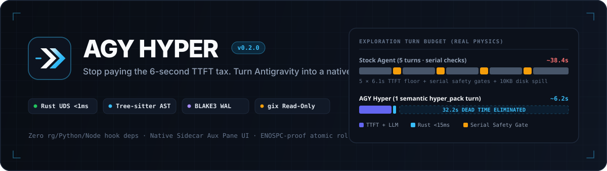
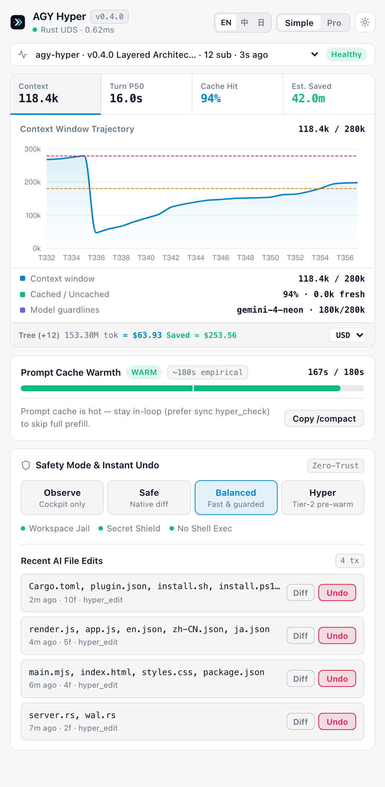
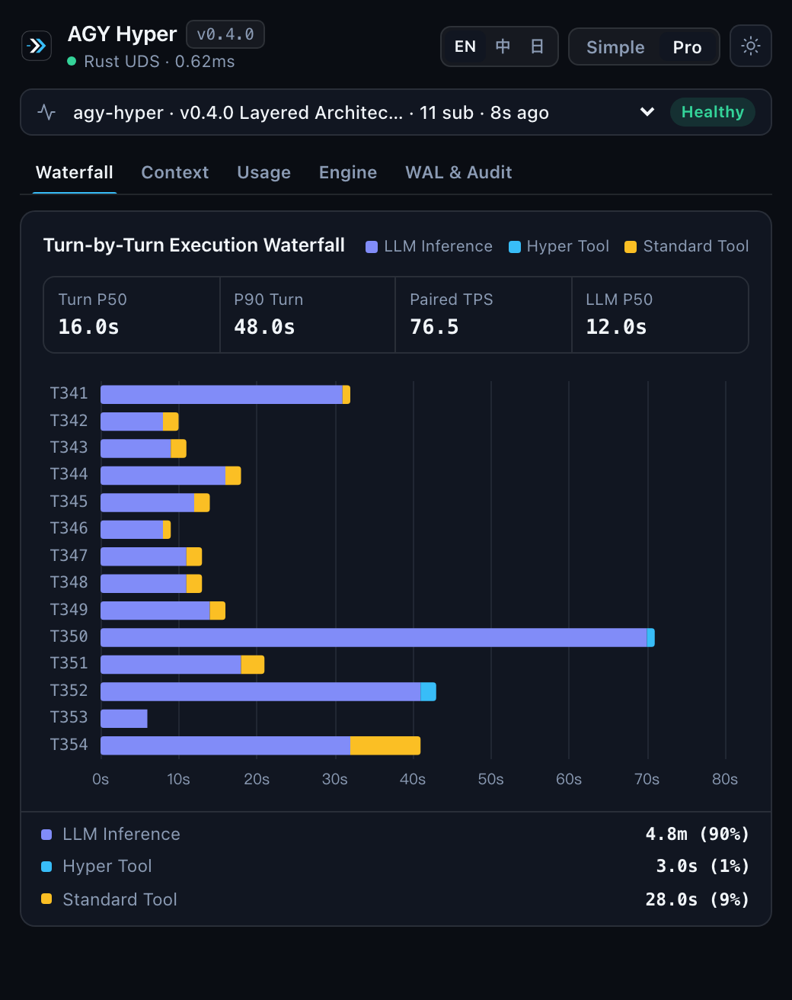
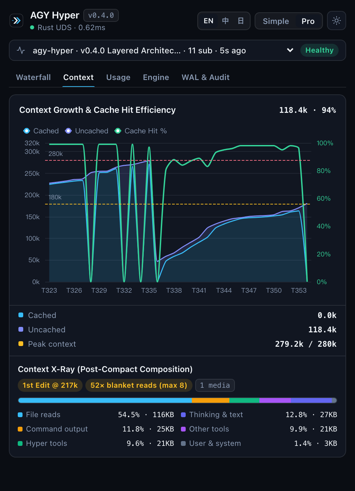
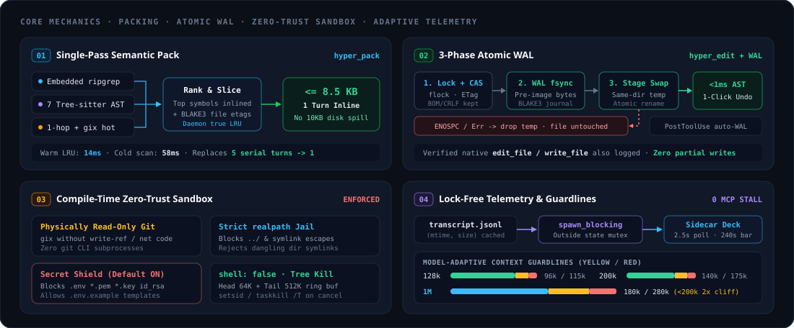
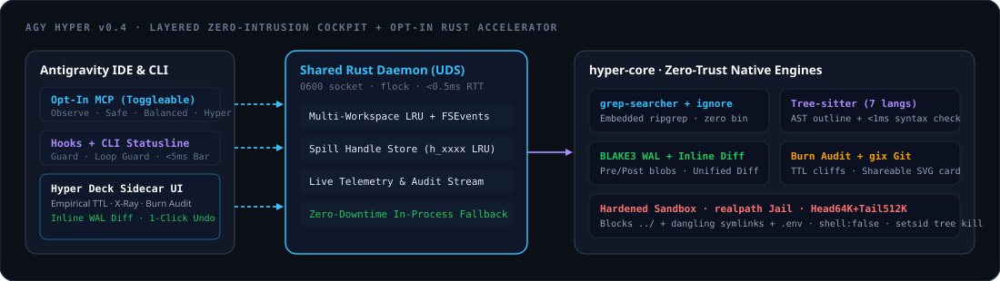

<div align="center">

<picture>
  <source media="(prefers-color-scheme: dark)" srcset="./assets/hero-dark.svg">
  <source media="(prefers-color-scheme: light)" srcset="./assets/hero-light.svg">
  
</picture>

<br/>

[](./LICENSE)
[](#系统架构)
[](#可复现实测数据)
[](#系统架构)
[](https://x.com/BobbyCat2025)

[English](./README.md) · **简体中文** · [参与贡献](./CONTRIBUTING.md)

</div>

---

让 AI 查一处鉴权逻辑，它先翻目录，再搜关键词，读到一半超 10KB 被截断落盘，接着再猜下一个文件。来回 5 轮，38 秒过去了，业务代码一行没改。拖慢节奏的往往是每一轮重新排队等大模型吐出第一个字。

**AGY Hyper 把这些冤枉路直接砍掉。** 一个 ~10MB、无需额外环境的纯 Rust 常驻引擎，把多轮代码摸底压进一次 `14ms` 内存缓存打包，给每一次多文件修改加上原子备份与一键撤回，并在 Antigravity 右侧边栏嵌入实时仪表盘。

---

## 10 秒看懂：装上之前 vs 装上之后

哪怕你平时不写底层代码，下面三组对比也能直接感受到差别。

### 1. 干活速度：来回跑五趟拿工具 vs 揣着户型图直接干
- **没装之前**：让 AI 修客厅漏水。它先跑一趟储藏室看眼管子（等 6 秒），回来问扳手放哪了（等 6 秒），再跑一趟发现工具箱太沉搬不动又扔在半路（输出超 10KB 截断落盘，再等 6 秒）。来回跑 5 趟，38 秒全耗在上下楼按电梯上。
- **装上之后**：出门前直接把整栋楼的户型图、水电表和关键源码切片一次塞进它手里。`14ms` 摸清全局，省掉 4 趟冤枉路，进门直接动手改代码。

### 2. 改文件安全：拿签字笔直接涂原件 vs 先锁保险柜再动笔
- **没装之前**：AI 一口气改 5 个文件，像拿不可擦的签字笔在合同原件上直接涂改。改到第 3 页突然报错崩掉，前两页已经面目全非。一不留神还顺手翻开你抽屉里的 `.env` 密钥文件。
- **装上之后**：动笔前先把原件逐字节锁进本地 WAL 保险柜，所有改动在临时草稿纸上写完、1 毫秒扫完语法错，再一整叠原子替换。改崩了？点一下侧边栏的 **一键撤回**，所有文件按字节恢复如初。抽屉里的密钥文件默认贴封条，AI 连瞄一眼都瞄不到。

### 3. 长对话不卡顿：蒙眼开盲车 vs 装上赛车仪表盘
- **没装之前**：聊着聊着 AI 突然变慢还变贵，甚至开始胡言乱语。你看不见它的缓存是不是已经凉了，也不知道上下文离红线还差多少，只能等它转圈超时才拍大腿。
- **装上之后**：Antigravity 右侧边栏长出一块实时仪表盘。记忆装了多少，60 秒缓存还有几秒变凉，刚才卡在模型还是卡在工具，什么时候该点一下复制 `/compact` 减负，一眼看穿。

---

## 一行安装，装完即用

不需要装 Rust，不需要装 `ripgrep` 或 Python，也不依赖本地 `git` 命令行。安装脚本强制通过 **SHA-256 校验** 后原子替换，绝不修改你的 `~/.gemini/config/config.json`。

```bash
# macOS & Linux
curl -fsSL https://raw.githubusercontent.com/BobbyCats/agy-hyper/main/install.sh | bash
```

```powershell
# Windows (PowerShell)
irm https://raw.githubusercontent.com/BobbyCats/agy-hyper/main/install.ps1 | iex
```

```bash
# 从源码构建安装
git clone https://github.com/BobbyCats/agy-hyper.git && cd agy-hyper && ./install.sh
```

装完切回 Antigravity 即可自动加载。随时也可以在终端体检，或者独立打开驾驶舱：

```bash
agy-hyper doctor   # 检查 Tree-sitter 语法、gix、守护进程延迟与安全边界
agy-hyper ui       # 在浏览器独立打开 AGY Hyper Deck (127.0.0.1:47821)
agy-hyper bench    # 对最近真实会话生成逐轮瀑布耗时分析
```

---

## AGY Hyper Deck（Antigravity 原生侧边栏驾驶舱）

通过官方 `SIDECAR_UI_ENTRYPOINT_AUX_PANE` 协议原生嵌入右侧边栏，100% 本地离线内置 **Apache ECharts 6** 与 **i18next**（`English / 简体中文 / 日本語`，零外网 CDN），自动同步宿主明暗主题。

- **简洁模式**面向日常使用：展示上下文水位与单轮 P50，搭配缓存命中条与一键撤回。
- **极客模式**面向深度调优：展开逐轮耗时火焰图和双轴上下文曲线，并附带内存索引命中率与零信任审计流。

<div align="center">
<table>
  <tr>
    <td align="center" width="50%">
      <strong>简洁模式 · 上下文水位与一键撤回（深色）</strong><br/>
      <sub>按模型自适应警戒线 · 60 秒缓存保鲜条 · WAL 一键原子还原</sub><br/><br/>
      
    </td>
    <td align="center" width="50%">
      <strong>简洁模式 · 引擎接管与索引命中（浅色 · 中文）</strong><br/>
      <sub>Hyper 接管占比 · AST / 打包实时命中 · 原生 i18next 多语言</sub><br/><br/>
      
    </td>
  </tr>
  <tr>
    <td align="center" width="50%">
      <strong>极客模式 · 逐轮耗时火焰图</strong><br/>
      <sub>严格拆分模型推理 / Hyper / 普通工具耗时 · P50 / P90 · 配对 TPS</sub><br/><br/>
      
    </td>
    <td align="center" width="50%">
      <strong>极客模式 · 双轴上下文与缓存命中曲线</strong><br/>
      <sub>缓存命中与新增输入堆叠面积 · 命中率曲线 · 180k / 280k 警戒线</sub><br/><br/>
      
    </td>
  </tr>
</table>
</div>

---

## 工作原理与安全边界

<div align="center">
<picture>
  <source media="(prefers-color-scheme: dark)" srcset="./assets/mechanics-dark.svg">
  <source media="(prefers-color-scheme: light)" srcset="./assets/mechanics-light.svg">
  
</picture>
</div>

<br/>

1. **单回合语义打包（`hyper_pack`）**：一次并行扫描完成内置 `ripgrep`、7 种 Tree-sitter 语法解析（Rust / TypeScript / TSX / JavaScript / Python / Go / JSON）、1-hop 导入图与 `gix` 热点排序，并内联高分符号切片。输出严格压在 `<= 8.5KB` 内，避开 Antigravity 10KB 落盘截断，守护进程真 LRU 热命中约 `14ms`。
2. **三阶段原子 WAL（`hyper_edit`）**：排他 `flock` 加 BLAKE3 ETag 乐观锁，先 `fsync` 写入修改前预像，再经同目录临时文件原子 `rename`。遇到磁盘满（`ENOSPC`）直接清理临时文件并中止，绝不破坏源文件。改完立刻做 `<1ms` 语法校验，原生 `edit_file` / `write_file` 验证后的修改前预像也会自动入账，统一支持一键撤回。
3. **编译期零信任沙箱**：只读 `gix` 在编译阶段去掉写引用与网络代码，全程零 `git` 子进程。`realpath` 牢笼拦截 `../`、软链接逃逸及悬空目录软链，密钥盾默认封禁 `.env` / `*.pem` / `*.key` / `id_rsa`（放行 `.env.example`）。`hyper_check` 固定 `shell: false`，保留头 64KB 加尾 512KB 环形缓冲，取消或超时按进程组整树清理。
4. **无锁遥测与自适应警戒线**：驾驶舱轮询与回滚均在守护进程全局锁外执行，并按 `(mtime, size)` 缓存 `transcript.jsonl` 解析结果，不会拖慢并发 MCP 请求。上下文警戒线按模型自动适配：`128k` 模型 `96k / 115k`，`200k` 模型 `140k / 175k`，`1M` 模型在 `200k` 阶梯计费悬崖前标出 `180k / 280k`。

---

## 系统架构

<div align="center">
<picture>
  <source media="(prefers-color-scheme: dark)" srcset="./assets/architecture-dark.svg">
  <source media="(prefers-color-scheme: light)" srcset="./assets/architecture-light.svg">
  
</picture>
</div>

### 5 个核心 MCP 工具（全员锁死 `<= 8.5KB` 内联）

压缩版参数 Schema 已预置在 `plugin/rules/AGENTS.md`，Agent 无需额外浪费回合去读工具定义即可直接调用。

| 工具 | 性质 | 能力 |
| :--- | :---: | :--- |
| `hyper_pack` | `只读` | 单遍 ripgrep + Tree-sitter 符号与核心切片 + 1-hop 导入图 + `gix` 热点 + BLAKE3 `etag`。 |
| `hyper_search` | `只读` | 多关键词并行纯 Rust 搜索，兼顾 `.gitignore` 文件列举与零子进程 `gix` 只读 Git 状态。 |
| `hyper_edit` | `原子 WAL` | 多文件精确替换或 Tree-sitter `symbol` 块级替换，含 ETag 乐观锁、BOM/CRLF 保护与 `<1ms` 语法校验。 |
| `hyper_check` | `沙箱验证` | 自动识别安全 Preset（`cargo:check` / `pkg:test` / `py:pytest` / `go:vet`），支持头尾环形缓冲与 `h_xxxx` 钻取句柄。 |
| `hyper_tx` | `撤回 / 钻取` | 查看 WAL 修改账本，支持一键原子 `rollback` 任意 `tx_id`，或 `1ms` 切片过滤超长检查日志。 |

---

## 可复现实测数据

Apple Silicon 实机 Release（LTO 优化）通过 `./bench/run-bench.sh` 实测（含完整冷进程启动与 MCP 握手开销）：

| 测试项 | 实测耗时 | 说明 |
| :--- | ---: | :--- |
| 常驻守护进程 UDS 心跳（`agy-hyper daemon status`） | **0.12 ms** | 单例 Unix Domain Socket（Windows 自动切带 Token 回环 TCP） |
| `hyper_pack`（守护进程 AST + 打包热命中） | **14 ms** | 含完整 MCP stdio 冷启与握手返回 |
| `hyper_search` + `gix` 只读 Git（单次调用） | **20 ms** | 对比基线 `git status && git log && grep -rn` 耗时 **43 ms**（**2.2x 提速**） |
| `hyper_pack`（冷启单遍 ripgrep + AST + 切片 + `gix` + 1-hop） | **58 ms** | 零外部 `rg` 与 `git` 二进制依赖 |
| Rust 单元与安全混沌测试全集（`29/29`） | **0.17 s** | 覆盖磁盘满 staging、悬空目录软链与多语言 1-hop，以及取消杀树和原生 WAL 防误删 |

在任意本地仓库一键复现：

```bash
./bench/run-bench.sh /path/to/your/repo
```

<details>
<summary><strong>展开查看：CLI 常用命令、工程口径与供应链校验</strong></summary>

```bash
agy-hyper doctor                        # 全链路 Tree-sitter、gix、守护进程与安全体检
agy-hyper daemon start|stop|status      # 管理本地共享 Rust 守护进程
agy-hyper ui [--port 47821]             # 在浏览器独立打开 AGY Hyper Deck
agy-hyper bench [--sessions 10] [--svg waterfall.svg] [--json]
agy-hyper tx list                       # 查看 BLAKE3 WAL 修改账本
agy-hyper tx rollback <tx_id> [--force] # 原子恢复文件到修改前字节状态
agy-hyper config profile safe|balanced|hyper
```

- **真实 Token 与压缩边界**：直读 Antigravity 最新 `PLANNER_RESPONSE` 的 `input_tokens + cache_read_tokens`，自动识别 `/compact` 重置步数与超时窗口。瞬态网络抖动（`proxy_reset` / `stream_timeout`）单独标注。
- **无水分瀑布归因**：`llm_inference_ms` 取规划开始到首个工具触发，`tool_exec_ms` 取首个工具触发到末个工具完成。剔除超 `180s` 人类停顿回合时，同步从分子剔除对应 `output_tokens`。
- **供应链纪律**：绝不在后台静默更新。每个发行版附带 `SHA256SUMS` 与 Sigstore/Cosign 构建来源证明。

</details>

---

## 参与共建与开源致谢

- **欢迎提 PR**：本项目采用完全开放的 **MIT 协议**（个人与企业工作电脑均可免费使用）。无论是新增 Tree-sitter 语言语法（C/C++/Java/Swift），补充构建 Preset 和多语言翻译，还是在 Windows / Linux 上提交实测反馈，都欢迎直接提 Issue 或 Pull Request。起步指引见 [CONTRIBUTING.md](./CONTRIBUTING.md)。
- **开源致谢**：本项目的探索缘起于 [INK-Q/agy-fast](https://github.com/INK-Q/agy-fast) 对 Antigravity 延迟与工具链路加速的先行尝试，感谢开源社区提供的启发。
- **关注作者**：AGY Hyper 由 [@BobbyCat2025](https://x.com/BobbyCat2025) 持续开源迭代。如果你对 Rust 工程提效、Antigravity 实战玩法以及 AI 工具拆解感兴趣，欢迎在 X 上关注交流：[x.com/BobbyCat2025](https://x.com/BobbyCat2025)。

---

MIT © [BobbyCats](https://github.com/BobbyCats) & AGY Hyper Contributors.
