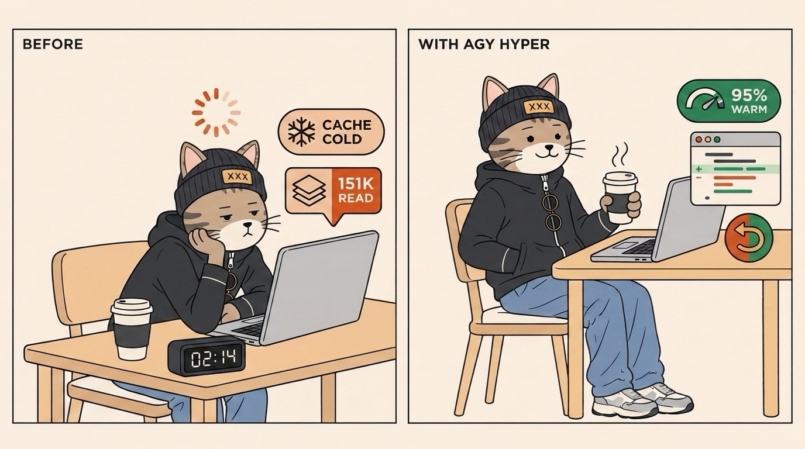
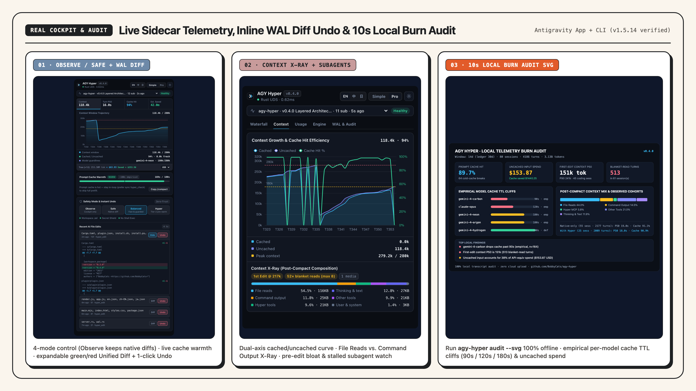
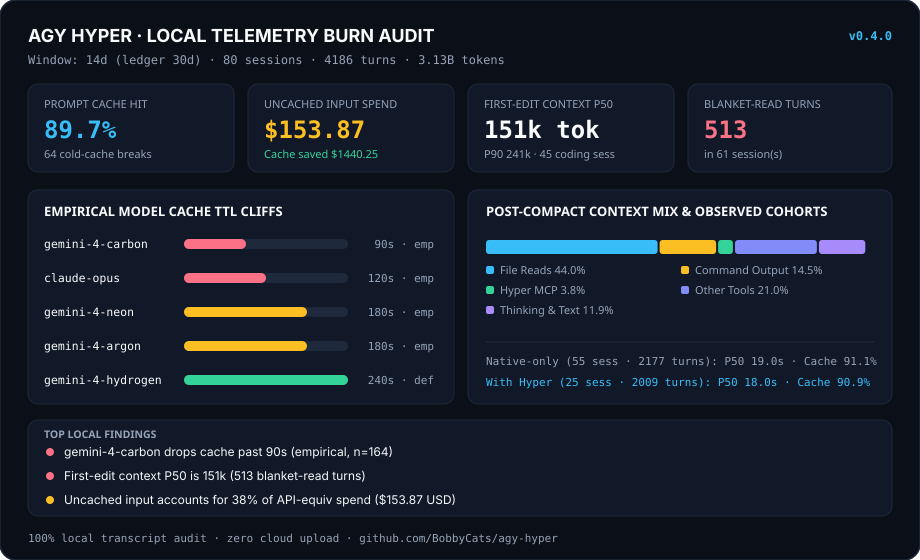
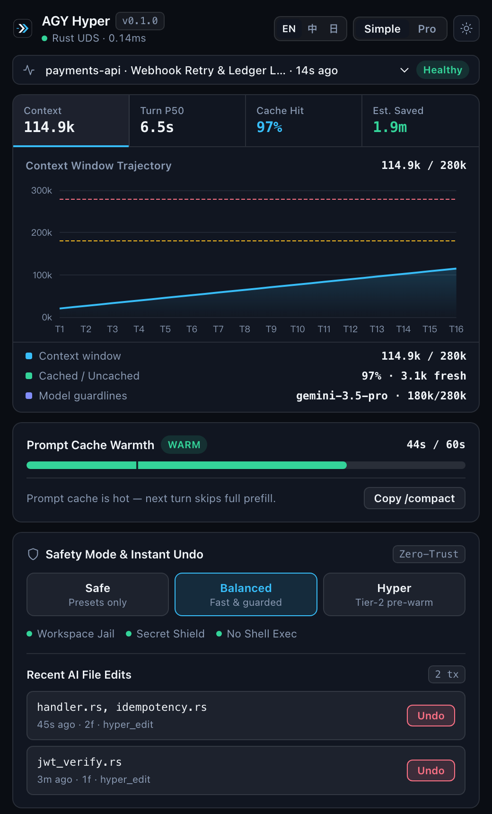
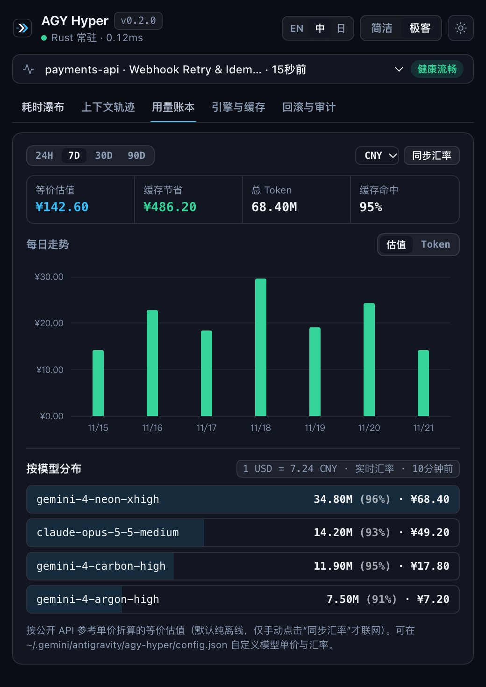
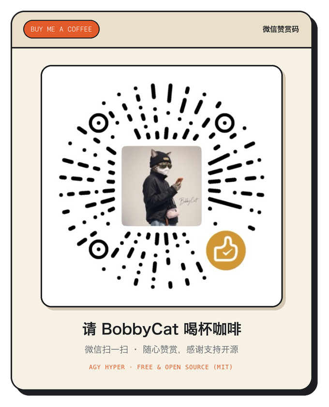

<div align="center">



<br/><br/>

# AGY Hyper

**Google Antigravity（桌面版 & CLI）的本地烧额度体检仪、实时缓存拐点驾驶舱、行级 WAL Diff 撤回与 Rust 加速侧边栏**

[](https://github.com/BobbyCats/agy-hyper/actions/workflows/ci.yml)
[](https://github.com/BobbyCats/agy-hyper/releases/latest)
[](./LICENSE)
[-16A34A.svg?style=flat-square)](#antigravity-cliagy完整支持)
[](#安全与透明说明)
[](https://x.com/BobbyCat2025)

[English](./README.md) · **简体中文** · [一行安装](#一行安装装完即用) · [CLI 支持](#antigravity-cliagy完整支持) · [实测报告](./docs/ANALYSIS_REPORT.md) · [安全透明](#安全与透明说明) · [实测基准](#可复现实测数据) · [卸载说明](#卸载与保留说明)

</div>

---

**10 秒看清你的 Antigravity 额度到底烧在了哪里——而且不用牺牲原生行内 Diff 对比卡片。**

复盘本机 **80 个真实会话（4,184 轮）** 后揪出两个最大元凶：一半编码任务在**改第一行代码前就已经靠盲读把上下文干到 `151k+`**；而且不同模型族的 Prompt 缓存保鲜拐点根本不一样（Carbon **`~90s`**、Opus **`~120s`**、Neon/Argon **`~180s`**）。**AGY Hyper** 提供 10 秒离线烧额度体检卡（`agy-hyper audit --png audit.png` 纯 Rust 直出 2x 高清 PNG / `--svg`）、实时侧边栏/终端缓存保鲜表、BLAKE3 WAL 行级 Diff 一键撤回，以及四档分层 Rust 加速（`Observe` / `Safe` / `Balanced` / `Hyper`）。

| 首次改代码前上下文膨胀 | 分模型实测缓存掉崖拐点 | 原生 Diff 卡片保留 | 本地引擎与 CLI 验证 |
| :---: | :---: | :---: | :---: |
| **`151.4k` P50**<br><sub>`241.3k` P90 · 读文件占 `44.9%` · [实测报告](./docs/ANALYSIS_REPORT.md)</sub> | **`90s` / `120s` / `180s`**<br><sub>Carbon / Opus / Neon · `38%` 费用死在未命中</sub> | **`Observe` & `Safe`**<br><sub>完全不丢原生 Diff · `Hyper` 内置红绿行级 Diff</sub> | **`0.13ms` UDS RTT**<br><sub>桌面侧边栏 + `agy` CLI（`v1.5.14` 实测通过）</sub> |

<div align="center">
  
</div>

> **100% 官方插件协议**：全程基于 Antigravity 官方 MCP、Lifecycle Hooks、Rules 与 `SIDECAR_UI_ENTRYPOINT_AUX_PANE` 构建（`agy plugin validate --strict` **0 警告通过**）。不注入 Electron DOM，不开启 `--remote-debugging-port`，不修改 `~/.gemini/config/config.json`，100% 本地离线。

---

## 一行安装，装完即用

推荐新手先用 **零侵入 `Observe` 纯观测模式**（只开实时驾驶舱、10 秒烧额度体检与被动 WAL 快照，完全不碰原生工具和行内 Diff 卡片），随时可在侧边栏一键切档：

```bash
# 推荐首装：零侵入 Observe 纯观测模式（macOS & Linux）
curl -fsSL https://raw.githubusercontent.com/BobbyCats/agy-hyper/main/install.sh | bash -s -- --observe

# 标准 Balanced 加速模式（macOS & Linux）
curl -fsSL https://raw.githubusercontent.com/BobbyCats/agy-hyper/main/install.sh | bash
```

```powershell
# Windows (PowerShell；安装前设 `$env:AGY_HYPER_OBSERVE="1"` 可启零侵入纯观测模式)
irm https://raw.githubusercontent.com/BobbyCats/agy-hyper/main/install.ps1 | iex
```

```bash
# 不想下载预编译包？直接从开源源码本地构建
git clone https://github.com/BobbyCats/agy-hyper.git && cd agy-hyper && ./install.sh --observe
```

> **可独立全包，也可与其他 MCP 插件无缝共存**：不管你现在只用 Antigravity 原生工具，还是已经配了其他 MCP 插件，都可以用 `--observe` 模式零冲突并排运行，原生行内 Diff 卡片 100% 保留，同时原地补齐实时缓存保鲜侧边栏、10 秒本机烧额度体检卡、上下文 X-Ray 与被动 WAL 改文件一键撤回。

### Antigravity CLI（`agy`）完整支持

已在真机 **`agy v1.5.14`** 端到端实测跑通（`agy plugin validate --strict` 0 警告通过，自动扫描 `~/.gemini/{antigravity,antigravity-ide,antigravity-cli}/brain/`）：

- `install.sh` / `install.ps1` 会自动检测本机 `agy` CLI 并执行 `agy plugin enable agy-hyper`。
- 一行命令挂载 `<2ms` 终端原生实时状态栏（上下文水位 + 当前模型缓存保鲜倒计时）：
  ```bash
  agy-hyper cli-setup --apply   # 自动先备份再写入 ~/.gemini/antigravity-cli/settings.json
  ```
- CLI 用户随时可打开完整可视化驾驶舱（ECharts、上下文 X-Ray、行级 Diff 撤回与 SVG 导出）：
  ```bash
  agy-hyper ui                  # 浏览器访问 http://127.0.0.1:47821
  ```

### 安全与透明说明

在自己的开发机上装本地工具，谨慎一点完全应该：

- **可核验构建**：所有 Release 归档均由公开 GitHub Actions（`.github/workflows/release.yml`）编译产出，配套 `SHA256SUMS`（安装脚本原子替换前强制校验）与 GitHub Artifact Attestations；如果不放心任何预编译包，直接 `git clone` 后运行 `./install.sh` 即可从 MIT 开源 Rust 源码本地编出二进制。
- **零遥测、零云端上传**：所有会话日志、WAL 快照、用量账本和 SVG 体检图全部留在本地 `~/.gemini/antigravity/agy-hyper/`。
- **严格工作区牢笼、`PLUGIN_ROOT` 防呆 + Secret Shield**：MCP 工具无法越界读写工作区外文件；当宿主未传 `workspace` 且默认落到插件安装目录 / `$HOME` / `/` 时立即 Fail-Fast 拦截防误扫；`hyper_check` 禁用通用 Shell（仅放行白名单构建/测试工具），`.env` 与密钥文件默认屏蔽。

### AI 一键安装与体检

将下面这段提示词直接发给 **Antigravity（桌面版 / CLI）/ Claude Code / Codex / Cursor**，AI 会按 [SKILL.md](./SKILL.md) 自动装好并跑完诊断：

> 请读取 `https://raw.githubusercontent.com/BobbyCats/agy-hyper/main/SKILL.md`，用 `--observe` 模式执行对应系统的安装脚本（macOS/Linux 用 `install.sh`，Windows 用 `install.ps1`），装完后运行 `agy-hyper doctor` 和 `agy-hyper audit` 并汇报体检结果。

常用终端命令：

```bash
agy-hyper audit --share           # 10 秒本机烧额度诊断 + 脱敏 2x 健康体检卡 PNG（零路径 / 零 UUID）
agy-hyper audit --png audit.png   # 完整版 2x 高清 PNG 诊断卡（1920x1200，纯 Rust 直出）
agy-hyper audit --svg audit.svg   # 导出深浅色矢量 SVG 诊断卡
agy-hyper doctor                  # 检查 Tree-sitter 语法、gix、守护进程延迟与安全边界
agy-hyper tx diff <tx_id>         # 撤回前先在终端审阅 WAL 快照的行级红绿 Diff
agy-hyper bench --cache-ttl       # 查看各模型族实测 Prompt 缓存衰减曲线与 TTL 拐点
agy-hyper usage --window 7d       # 查看近 24h / 7d / 30d / 90d Token 与多币种等价估值
agy-hyper ui                      # 在浏览器独立打开 AGY Hyper Deck (127.0.0.1:47821)
```

---

## 本机烧钱诊断、切模型/子代理缓存分析与脱敏分享卡（`agy-hyper audit`）

运行 `agy-hyper audit --days 14 --png audit-card.png`（或 `--svg audit-card.svg`），100% 本地离线扫描你自己的 Antigravity 历史日志（零云端上传、零外部浏览器/ImageMagick 依赖），定位各模型真实缓存掉崖时间、未命中输入成本、首次改代码前上下文膨胀、地毯式预读次数，以及 **切模型 / 主控→子代理缓存分裂损耗**（统计跨模型切换与父子代理交接时的缓存命中骤降与未命中 Token 惩罚）。

如需对外分享体检结果又不暴露隐私，运行 `agy-hyper audit --share`（默认生成 `1920x1080` 2x `agy-hyper-share-card.png`，也可指定 `--share-svg badge.svg` / `--share-png badge.png`）：输出带明确健康评级（`BLEEDING` / `WATCH` / `HEALTHY`）与核心指标（`Cache Hit %`、`First-Edit Blind Read P50`、`Split/Switch Cache Drop`、`Top Quota Drain`）的脱敏卡片，并在代码层**强制零泄露脱敏**（剥离全部本机路径、用户名、仓库/工作区名、会话 UUID 与提示词片段）。

<div align="center">
  <picture>
    <source media="(prefers-color-scheme: dark)" srcset="./assets/audit-card-dark.svg">
    <source media="(prefers-color-scheme: light)" srcset="./assets/audit-card-light.svg">
    
  </picture>
</div>

---

## AGY Hyper Deck（Antigravity 原生侧边栏驾驶舱）

通过官方 `SIDECAR_UI_ENTRYPOINT_AUX_PANE` 协议原生嵌入右侧边栏，100% 本地离线内置 **Apache ECharts 6** 与 **i18next**（`English / 简体中文 / 日本語`，零外网 CDN），自动同步宿主明暗主题。

- **分层零侵入架构**：支持先用 **纯观测（Observe）** 模式（只开侧边栏驾驶舱、烧钱诊断与被动 WAL 快照，完全不碰原生工具与 Diff 卡片），或切到 **安全稳健（Safe）**（开启打包读与同步校验，同时保留原生 `edit_file` 行内 Diff），也可以一键解锁 **均衡 / 狂暴** 全量 Rust MCP 加速，并在 **引擎** 页独立开关读/写/校验三个工具层。
- **简洁模式**面向日常使用：展示上下文水位、单轮 P50、本步与会话累计缓存命中、**子代理树状态条**（高亮运行中红线、静默 `>=90s` 的 `STALLED` 卡死、连续报错的 `连崩 ×N` 子代理并支持**一键救援**复制恢复指令，以及主控→子代理切换缓存掉率徽章）、**本会话/整树等价估值缎带**（支持一键切货币）、**分模型自适应缓存保鲜条**（实测/默认 TTL 徽章与连续失败熔断预警 + **一键复制止损指令**）、四档分层模式切换，以及 **WAL 行级 Unified Diff 内联审阅 + 一键撤回**。
- **极客模式**展开五大深度视图：**耗时瀑布**（LLM / Hyper / 普通工具严格拆分）、**上下文轨迹**（双轴堆叠面积曲线 + **上下文 X-Ray 透视条** + 当前会话**切模型与子代理缓存损耗**明细）、**用量账本**（`24H / 7D / 30D / 90D` 增量统计 + 8 种货币 + 手动 **同步汇率** + **本机烧钱诊断与 TTL 断崖**，内置健康评级、**切模型/子代理缓存诊断**与一键**脱敏分享体检卡** PNG/SVG 导出及内联预览）、**引擎与缓存**（AST/打包命中 + 细粒度 MCP 开关）、**回滚与审计**。

<div align="center">
<table>
  <tr>
    <td align="center" width="50%">
      <strong>简洁模式 · 实测 TTL、四档模式与行级 WAL Diff（深色）</strong><br/>
      <sub>~180s 实测缓存保鲜 · Observe/Safe/Balanced/Hyper · 展开红绿 Diff 与一键撤回</sub><br/><br/>
      
    </td>
    <td align="center" width="50%">
      <strong>简洁模式 · 浅色主题与改动行数标记（浅色）</strong><br/>
      <sub>自适应宿主浅色主题 · 实测 TTL 徽章 · 原生 i18next 三语切换</sub><br/><br/>
      
    </td>
  </tr>
  <tr>
    <td align="center" width="50%">
      <strong>极客模式 · 用量账本、烧钱诊断与模型 TTL 断崖</strong><br/>
      <sub>多币种本地账本 · 实测断崖胶囊 · 核心发现 · 一键导出 SVG 战报卡</sub><br/><br/>
      
    </td>
    <td align="center" width="50%">
      <strong>极客模式 · 双轴上下文曲线与上下文 X-Ray 透视</strong><br/>
      <sub>命中率双轴轨迹 · 压缩后窗口成分拆解 · 首改水位与地毯读计数</sub><br/><br/>
      
    </td>
  </tr>
</table>
</div>

<details>
<summary><strong>更多视图：极客模式 · 逐轮耗时火焰图</strong></summary>
<br/>
<div align="center">
  
</div>
</details>

---

## 工作原理与安全边界

<div align="center">
<picture>
  <source media="(prefers-color-scheme: dark)" srcset="./assets/mechanics-dark.svg">
  <source media="(prefers-color-scheme: light)" srcset="./assets/mechanics-light.svg">
  
</picture>
</div>

<br/>

1. **单回合语义打包（`hyper_pack`）**：一次并行扫描完成内置 `ripgrep`、7 种 Tree-sitter 语法解析（Rust / TypeScript / TSX / JavaScript / Python / Go / JSON）、1-hop 导入图与 `gix` 热点排序，并内联高分符号切片。输出严格压在 `<= 8.5KB` 内，避开 Antigravity 10KB 落盘截断，守护进程真 LRU 热命中约 `14ms`。
2. **三阶段原子 WAL（`hyper_edit`）**：排他 `flock` 加 BLAKE3 ETag 乐观锁，先 `fsync` 写入修改前预像，再经同目录临时文件原子 `rename`。遇到磁盘满（`ENOSPC`）直接清理临时文件并中止，绝不破坏源文件。改完立刻做 `<1ms` 语法校验，原生 `edit_file` / `write_file` 验证后的修改前预像也会自动入账，统一支持一键撤回。
3. **编译期零信任沙箱与防卡死看门狗**：只读 `gix` 在编译阶段去掉写引用与网络代码，全程零 `git` 子进程。`realpath` 牢笼拦截 `../`、软链接逃逸及悬空目录软链，密钥盾默认封禁 `.env` / `*.pem` / `*.key` / `id_rsa`（放行 `.env.example`）。`hyper_check` 固定 `shell: false`，保留头 64KB 加尾 512KB 环形缓冲，为测试与脚本提供智能静默看门狗（`idle_timeout_secs`）与双条件崩溃断电（`fail_fast`），同时对编译与静态检查 Preset 默认免杀防误伤；超时、中止或取消均按进程组整树清理。
4. **无锁遥测、实测 TTL、上下文 X-Ray、子代理看门狗与 CLI 状态栏**：驾驶舱轮询、CLI `StatuslinePulse`、回滚及字节偏移增量账本（`usage_ledger.json` v2，180 天滚动保留，8 种货币换算）均在守护进程全局锁外执行，绝不拖慢并发 MCP 请求。账本按模型族自动统计冷暖衰减拐点校准真实缓存 TTL（`agy-hyper bench --cache-ttl`）；单遍扫描产出 `/compact` 后的上下文 X-Ray 构成、首次改动水位，并统一识别上游传输异常（`EOF` / 流中断 / TLS 与 TCP 超时）与 `CHECKPOINT` 边界；`PreInvocation` 在模型自适应水位线（`96k / 115k`、`140k / 175k`、`180k / 280k`）之外提供分角色连续报错熔断（`[AGY Hyper Loop Guard]`）与父会话跨层子代理告警（`[AGY Hyper Subagent Watchdog]`）；守护进程自带可一键开关的 1-shot 系统桌面看门狗提醒（`enable_watchdog_notify`，支持 `AGY_HYPER_NO_NOTIFY=1` 关闭），即便未展开侧边栏也能及时感知卡死/连崩子代理；`agy-hyper statusline` 支持 `<5ms` 输出 Antigravity CLI 原生状态栏（含异常子代理计数）与纯文本窗口标题。

---

## 系统架构

<div align="center">
<picture>
  <source media="(prefers-color-scheme: dark)" srcset="./assets/architecture-dark.svg">
  <source media="(prefers-color-scheme: light)" srcset="./assets/architecture-light.svg">
  
</picture>
</div>

### 5 个核心 MCP 工具（全员锁死 `<= 8.5KB` 内联）

压缩版参数 Schema 已预置在 `plugin/rules/AGENTS.md`，Agent 无需额外浪费回合去读工具定义即可直接调用。

| 工具 | 性质 | 能力 |
| :--- | :---: | :--- |
| `hyper_pack` | `只读` | 单遍 ripgrep + Tree-sitter 符号与核心切片 + 1-hop 导入图 + `gix` 热点 + BLAKE3 `etag`。 |
| `hyper_search` | `只读` | 多关键词并行纯 Rust 搜索，兼顾 `.gitignore` 文件列举与零子进程 `gix` 只读 Git 状态。 |
| `hyper_edit` | `原子 WAL` | 多文件精确替换或 Tree-sitter `symbol` 块级替换，含 ETag 乐观锁、BOM/CRLF 保护与 `<1ms` 语法校验。 |
| `hyper_check` | `沙箱验证` | 自动识别安全 Preset（`cargo:check` / `pkg:test` / `py:pytest` / `go:vet` 及 Monorepo 子包），内置智能静默/崩溃看门狗、头尾环形缓冲与 `h_xxxx` 钻取句柄。 |
| `hyper_tx` | `撤回 / 钻取` | 查看 WAL 修改账本，支持一键原子 `rollback` 任意 `tx_id`，或 `1ms` 切片过滤超长检查日志。 |

---

## 可复现实测数据

Apple Silicon 实机 Release（LTO 优化）通过 `./bench/run-bench.sh` 实测（含完整冷进程启动与 MCP 握手开销）；GitHub Actions CI 在 **Ubuntu / macOS / Windows** 上持续验证 Rust 单测、Sidecar 语法与多语言一致性以及 Release 构建：

| 测试项 | 实测耗时 | 说明 |
| :--- | ---: | :--- |
| 常驻守护进程 UDS 心跳（`agy-hyper daemon status`） | **0.12 ms** | 单例 Unix Domain Socket（Windows 自动切带 Token 回环 TCP） |
| `hyper_pack`（守护进程 AST + 打包热命中） | **14 ms** | 含完整 MCP stdio 冷启与握手返回 |
| `hyper_search` + `gix` 只读 Git（单次调用） | **20 ms** | 对比基线 `git status && git log && grep -rn` 耗时 **43 ms**（**2.2x 提速**） |
| `hyper_pack`（冷启单遍 ripgrep + AST + 切片 + `gix` + 1-hop） | **58 ms** | 零外部 `rg` 与 `git` 二进制依赖 |
| `agy-hyper statusline`（守护进程热脉冲 + CLI stdin） | **4.2 ms** | 含进程冷启、无锁 UDS 通信与渲染（任何异常保证 `exit 0`） |
| Rust 单元与安全混沌测试全集（`61/61`） | **2.1 s** | 覆盖磁盘满 staging、悬空软链、4 语言 1-hop、WAL 回滚、静默/崩溃看门狗、多生态语义诊断分类、传输错误与检查点识别、子代理连崩看门狗与 1-shot 桌面告警、实测 TTL 迁移、上下文 X-Ray、循环熔断、CLI 状态栏、纯 Rust 2x PNG 战报直出与 MCP `PLUGIN_ROOT` 防呆 |

### 端到端受控配对 A/B 实测（`agy` CLI）

在同一提交的隔离 `git worktree` 上、同模型（`gemini-4-neon-medium`、`agy v1.5.14`）与共享预热 `CARGO_TARGET_DIR` 下顺序执行 3 项真实工程任务（**两组均为 3/3 全通过、0 工具报错**）：

| 任务 | 原生 Antigravity | AGY Hyper（`Balanced`） | 实测变化 |
| :--- | :--- | :--- | :--- |
| **T1 · 跨模块安全边界追踪**（只读） | 9 轮 · 24 次工具 · 460.8K 总上下文 · 136.4s 净耗时* | **5 轮 · 13 次工具 · 187.8K 总上下文 · 87.0s** | **轮次 -44.4% · 工具 -45.8% · 上下文 -59.2% · 净耗时 -36.2%** |
| **T2 · 跨文件新增 `--scale` 参数与单测** | 7 轮 · 16 次工具 · 218.4K 总上下文 · 142.0s | **6 轮 · 10 次工具 · 180.0K 总上下文 · 101.3s** | **轮次 -14.3% · 工具 -37.5% · 上下文 -17.6% · 耗时 -28.7%** |
| **T3 · 双生产 Bug 定位修复与回归** | 6 轮 · 7 次工具 · 191.9K 总上下文 · 68.6s 净耗时* | **6 轮 · 8 次工具 · 168.6K 总上下文 · 90.5s** | **轮次持平 · 上下文 -12.1% · 未缓存输入 -8.2%**（短路径定向改） |
| **三项合计（3/3 通过 vs 3/3 通过）** | **22 轮 · 47 次工具 · 871.0K 上下文（未缓存 `147.9K`）· 347.0s 净耗时*** | **17 轮 · 31 次工具 · 536.4K 上下文（未缓存 `132.6K`）· 278.8s** | **轮次 -22.7% · 工具 -34.0% · 总上下文 -38.4% · 未缓存 -10.3% · 净耗时 -19.7%** |

> \* *净耗时已主动剔除原生对照组遭遇的 3 次上游 API 瞬态重试等待（T1 约 `53s`、T3 约 `107s`；AGY Hyper 组 `0` 次重试；含重试原始墙钟为 `507.0s` vs `278.8s`，`-45.0%`）。收益最大落在跨文件检索与多文件读改测闭环；单测已直接指明行号的极小范围双文件修复原本链路就短，二者耗时接近但仍节省上下文并附带 WAL 原子留档。*

在任意本地仓库一键复现：

```bash
./bench/run-bench.sh /path/to/your/repo
```

<details>
<summary><strong>展开查看：CLI 常用命令、工程口径与供应链校验</strong></summary>

```bash
agy-hyper doctor                                # 全链路 Tree-sitter、gix、守护进程与安全体检
agy-hyper daemon start|stop|status              # 管理本地共享 Rust 守护进程
agy-hyper ui [--port 47821]                     # 在浏览器独立打开 AGY Hyper Deck
agy-hyper audit [--days 14] [--sessions 80] [--share [card.png]] [--share-png card.png] [--share-svg card.svg] [--png card.png] [--svg card.svg] [--theme dark|light] [--json]
agy-hyper usage [--window 24h|7d|30d|90d] [--currency CNY] [--json]
agy-hyper bench [--sessions 10] [--svg waterfall.svg] [--cache-ttl] [--json]
agy-hyper statusline [--format compact|rich|json] [--title] [--no-color]
agy-hyper cli-setup [--apply] [--format compact|rich]  # 打印或显式写入 Antigravity CLI 状态栏与标题配置
agy-hyper tx list                               # 查看 BLAKE3 WAL 修改账本
agy-hyper tx diff <tx_id> [--json]              # 查看任意 WAL 事务的行级 Unified Diff
agy-hyper tx rollback <tx_id> [--force]         # 原子恢复文件到修改前字节状态
agy-hyper config show                           # 查看当前生效配置
agy-hyper config profile observe|safe|balanced|hyper    # 切换分层观测 / 加速模式
agy-hyper config toggle enable_mcp_read|enable_mcp_edit|enable_mcp_check true|false
agy-hyper config currency USD|CNY|JPY|EUR|GBP|HKD|SGD|KRW
agy-hyper config fx <货币代码> <对美元汇率>       # 自定义本地离线汇率
```

- **真实 Token 与压缩边界**：直读 Antigravity 最新 `PLANNER_RESPONSE` 的 `input_tokens + cache_read_tokens`，自动识别 `/compact` 重置步数、解释跨模型缓存重算、过滤用户主动取消，并单独标注瞬态网络抖动（`proxy_reset` / `stream_timeout`）。
- **诚实用量与多币种估值**：字节偏移增量扫描本地日志写入 `usage_ledger.json`，Rust 核心全程零外网请求。历史未标注模型的旧日志计入总 Token 但不虚估费用（面板透明展示归因占比）；汇率默认采用离线基准，仅在手动点击 **同步汇率** 时发起一次按需同步。
- **无水分瀑布归因**：`llm_inference_ms` 取规划开始到首个工具触发，`tool_exec_ms` 取首个工具触发到末个工具完成。剔除超 `180s` 人类停顿回合时，同步从分子剔除对应 `output_tokens`。
- **供应链纪律**：绝不在后台静默更新。每个发行版附带 `SHA256SUMS` 与 Sigstore/Cosign 构建来源证明。

</details>

---

## 卸载与保留说明

随时可以干净卸载，无残留：

```bash
# macOS & Linux（默认保留你的配置、用量账本与 WAL 撤回快照）
curl -fsSL https://raw.githubusercontent.com/BobbyCats/agy-hyper/main/install.sh | bash -s -- --uninstall

# macOS & Linux（彻底清空，包括配置与 WAL 快照）
curl -fsSL https://raw.githubusercontent.com/BobbyCats/agy-hyper/main/install.sh | bash -s -- --uninstall --purge
```

```powershell
# Windows PowerShell（默认保留配置、账本与 WAL 快照）
$env:AGY_HYPER_UNINSTALL = "1"; irm https://raw.githubusercontent.com/BobbyCats/agy-hyper/main/install.ps1 | iex

# Windows PowerShell（彻底清空）
$env:AGY_HYPER_UNINSTALL = "1"; $env:AGY_HYPER_PURGE = "1"; irm https://raw.githubusercontent.com/BobbyCats/agy-hyper/main/install.ps1 | iex
```

- **移除范围**：停止本地 Rust 守护进程与 Hyper Deck 侧边栏服务，删除 `~/.gemini/config/plugins/agy-hyper`，清理 `~/.local/bin/agy-hyper` 软链（Unix）或用户 `PATH` 中的插件目录（Windows）。
- **默认保留**：保留 `~/.gemini/antigravity/agy-hyper/`（`config.json`、`usage_ledger.json` 与 `wal/` 撤回快照），防止误删自定义单价或文件备份；如需彻底清空，追加 `--purge`（Windows 为 `-Purge`）即可。安装与卸载全程均不触碰 `~/.gemini/config/config.json`。

---

## 关于作者、参与共建与开源致谢

作者 **BobbyCat**（X：[`@BobbyCat2025`](https://x.com/BobbyCat2025) · [GitHub](https://github.com/BobbyCats)）。如果 AGY Hyper 帮你揪出了莫名掉额度的真凶，或者在半夜改歪代码时靠一键 WAL Undo 救了场，欢迎来 X 找我交流——我平时会持续分享 Rust AI 工具、Antigravity 实战拆解以及背后的真实日志数据。

<details>
<summary>☕ <strong>如果 AGY Hyper 帮到你了，欢迎请我喝杯咖啡（Buy Me a Coffee · 微信赞赏）</strong></summary>
<br/>
<div align="center">
  
</div>
</details>

<br/>

- **欢迎提 PR**：本项目采用完全开放的 [MIT 协议](./LICENSE)（个人与企业工作电脑均可免费使用）。无论是新增 Tree-sitter 语言语法（C/C++/Java/Swift），补充构建 Preset 和多语言翻译，还是在 Windows / Linux 上提交实测反馈，都欢迎直接提 Issue 或 Pull Request，起步指引见 [CONTRIBUTING.md](./CONTRIBUTING.md)。
- **开源致谢**：本项目的探索缘起于 [INK-Q/agy-fast](https://github.com/INK-Q/agy-fast) 对 Antigravity 延迟与工具链路加速的先行尝试，感谢开源社区提供的启发。

---

MIT © [BobbyCats](https://github.com/BobbyCats) & AGY Hyper Contributors.
